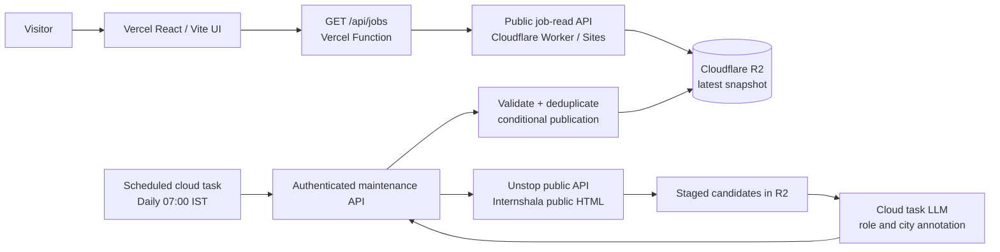

# Architecture

## Request path

1. The browser loads the React/Vite app from Vercel.
2. Its same-origin `GET /api/jobs` request runs `web/api/jobs.js`.
3. That server-side adapter fetches the public Cloudflare job-read endpoint. No maintenance token is needed for reads.
4. The Worker reads `latest.json` from R2, removes records with known expired deadlines, and returns the snapshot.
5. The browser searches/filters/sorts that dataset locally. While open, it checks the API every 60 seconds. Browser polling is not the daily collection scheduler.

The Vercel adapter uses a fixed upstream URL, rejects non-GET methods, disables response caching, validates the basic response shape, and returns a visible failure instead of fabricating fallback data.

## Update path

1. The linked cloud task obtains Site service access and reads `/api/maintenance`.
2. It calls `/api/collect` with the dedicated updater header.
3. The Worker fetches three 100-item Unstop pages and the public Internshala internship page.
4. Unstop rows must be LIVE, have open registration, have the internship subtype, not have a known expired deadline, and be India-based where an explicit country exists. Internshala cards must contain `employment_type="internship"`.
5. Repeated source IDs are removed. Tags are reused only when title, company, raw location, mode, and description match a previously tagged record.
6. A UUID identifies the staged run. The task pages through candidates needing annotations, interprets source text as data, and sends LLM role/city decisions in batches of at most 40.
7. Publication rejects missing tags, expired runs, outdated base snapshots, and a final count below 200.
8. Deduplication uses normalized company + title without intern/internship suffix + normalized city set.
9. The Worker archives the new snapshot and replaces `latest.json` using an R2 ETag precondition. Competing/stale publication attempts return a conflict.
10. The task reads the persisted count, run ID, update timestamp and health endpoint to verify the result.

## R2 objects

- `latest.json`: current published snapshot.
- `snapshots/{runId}.json`: archived successful snapshot.
- `runs/{runId}.json`: staged source records and base revision.
- `runs/{runId}/tags/{jobId}.json`: LLM annotations for a staging run.
- `last-attempt.json`: latest recorded collection failure or publication success.

The initial source dataset in `collector/data/seed.json` is a real fallback snapshot from the original build; it is not the production source of truth once R2 has a successful publication.

## Boundaries and limitations

- No user login is required for the public board.
- Only a holder of the Site-scoped updater credential may use maintenance routes.
- The Worker stores only the credential's verification digest in runtime configuration.
- Vercel receives public job data only.
- LLM execution is supplied by the scheduled cloud task, not by a model SDK in the web request path.
- The schedule is outside this Git repository; the instructions are checked in for reproducibility.
- Both source fetches must succeed before publication. This preserves consistency but makes either source outage block a fresh snapshot.
- The UI's device-local bookmarks remain separate across the old and new website origins.

## Product review layer and local workspace

The Vercel adapter validates records and applies the [source-bound review layer](product-upgrade.md). GET /api/status separately reads public collection health. React keeps skills, application stages, notes and follow-up dates locally and performs literal term matching. The Evidence dashboard exposes the baseline audit and live health without claiming to verify scheduler-run history.
