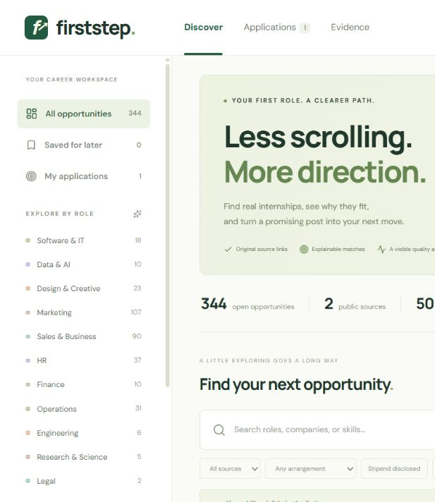
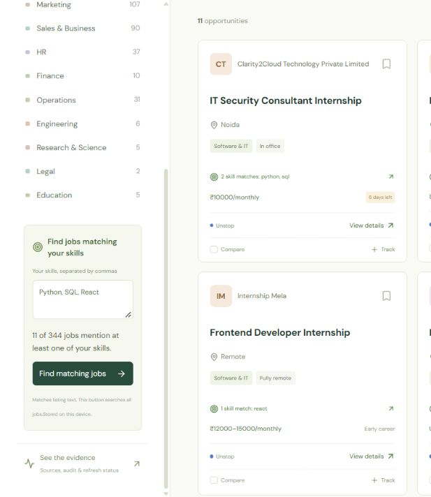
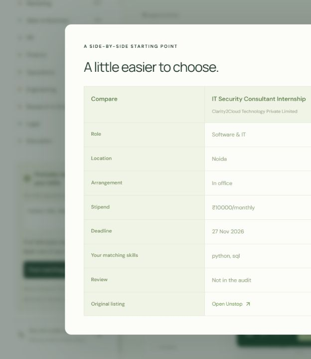

# FirstStep India: three findings and supporting evidence

## 1. Real listings can meet the target, but combined feeds need cleaning

The 19 November 2026 collection contained **349 posts: 299 from Unstop and 50 from Internshala**. Removing **2 duplicates** left **347 active listings**, above the 200-post target. This shows the board can be populated with real source records instead of invented example jobs. Keeping source links and collection times also lets users check the information before applying.

**Where:** the captured collection snapshot, run `3ec15a16-a4f5-4d83-9f0e-5ab8341092ed`; the working sheet's Submission rows 23–26 and Job data tab. Snapshot collected at `2026-11-19T01:28:13.624Z`.

**Why it matters:** a useful job board needs enough unique opportunities and a way to trace them back to their sources. This single snapshot establishes the count, not that every employer is verified or every post remains open indefinitely.

## 2. AI tags are useful, but source details still need checking

A fixed **50-post AI-assisted review** against fresh original sources found strict agreement of **48/50 for role (96%), 46/50 for location (92%), and 44/50 for both together (88%)**. Unclear cases stayed in the denominator. Two location differences concerned retaining a reference city alongside Remote rather than using Remote alone. One role mismatch occurred because the source changed from HR to UI/UX after collection. These results are not independent human validation.

**Where:** [all 50 decisions and source links](audits/2026-11-19/reviewed-posts.csv), [full review and scoring rules](tagging-audit-2026-11-19.md), and the working sheet's Reviewed posts tab. Rows are identified by the Number column, not spreadsheet row position.

**Why it matters:** a title or Remote label can hide important details. The app should retain original source links, flag conflicting information and expire old review corrections when the stored source input changes. The 88% strict score is not a claim that all remaining 12% are factual errors.

## 3. The estimated tagging-token budget is small, with a clear scope

Using **GPT-5.6 Luna as the pricing reference**, the captured sample gives an estimated **$0.093412, about $0.09, per 1,000 newly tagged posts**. The budget projects 341,780 input tokens and 20,880 visible output tokens per 1,000 posts. It covers a hypothetical single API pass, not hosting, collection, retries, extra reasoning tokens or the actual cloud-task bill. Unchanged records reuse their existing tags, so collected posts and newly tagged posts are different workloads.

**Where:** the working sheet's Cost model tab, [token counts and rate assumptions](audits/2026-11-19/cost-estimate.json), [estimator](audits/2026-11-19/estimate_cost.py), and [published model rates](https://developers.openai.com/api/docs/models/gpt-5.6-luna), checked 19 November 2026. This is not a claim that the deployed tagger uses that API model or that the audit benchmarks that model.

**Why it matters:** the calculation makes the expected token expense visible and gives a starting budget. Actual usage needs measurement before claiming a measured operating cost.

## Working evidence

- [Live project](https://firststep-india.vercel.app)
- [Working Google Sheet: data, review decisions, tools, prompts, cost formulas and screenshot links](https://docs.google.com/spreadsheets/d/1OKOd_ZQoaYNwI9sOyNGLD7ys58WEONCrgWbBTAMLd9k/edit)
- [Recorded AI tools and prompt context](competition-submission.md)
- Video: the user's face-and-screen recording link must be supplied separately; no URL has been provided yet.

## Screenshots

Captured on **21 November 2026** from the live app. The displayed feed was collected on **20 November**, with **344 active posts**. It is a later snapshot than the fixed 19 November research dataset of 347 posts. Daily counts can change; these screenshots do not replace the archived review evidence.

### Job board

### Skill matching

Python, SQL and React produced 11 matching listings in the captured view. The cards show which terms matched.

### Job comparison

The comparison places two original listings side by side, including arrangement, stipend, deadline and matching skills.

The repository is private. Give judges access to the repository and working sheet before submitting their links.
